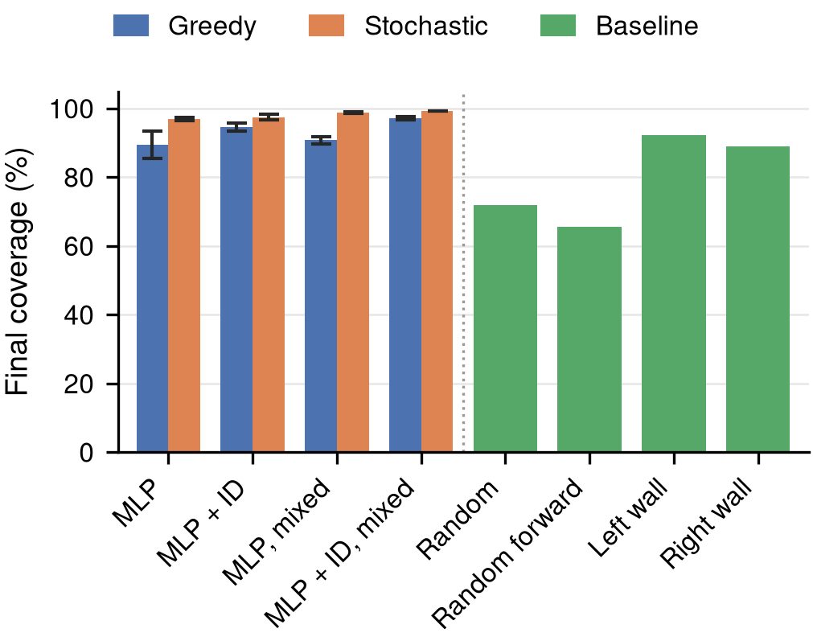
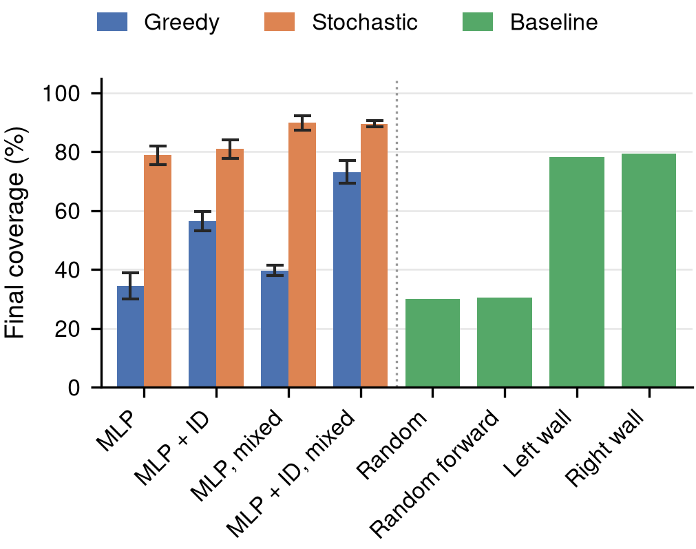
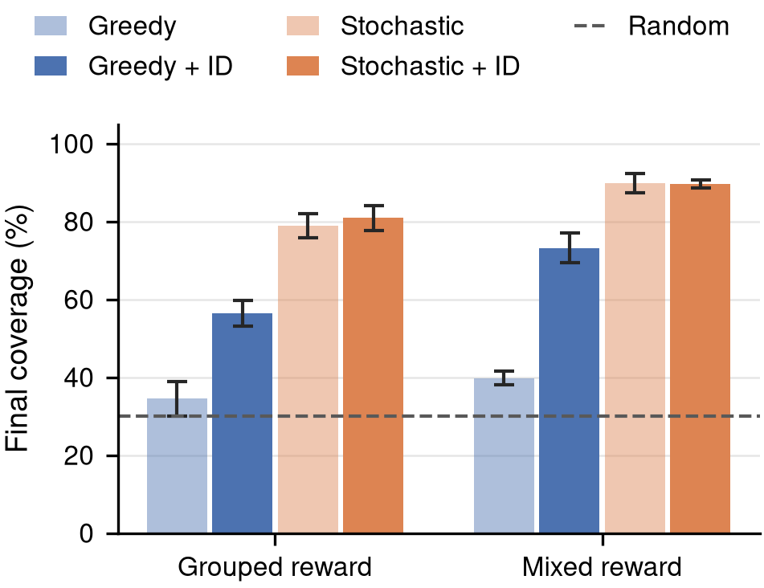

## Vue d'ensemble

### Petites cartes (`small_maps/val`, 15x15)

| Condition | Mode | Couverture finale | Épisodes à 100 % | Épisodes à 90 % | Pas pour 90 % |
| --- | --- | --- | --- | --- | --- |
| MLP, récompense groupée | greedy | 89.5 % ± 4.0 | 30.5 % ± 5.9 | 58.1 % ± 6.4 | 73 ± 9 |
| MLP, récompense groupée | stochastic | 96.9 % ± 0.5 | 61.4 % ± 2.8 | 88.1 % ± 2.5 | 63 ± 2 |
| MLP + ID, récompense groupée | greedy | 94.7 % ± 1.2 | 48.0 % ± 7.2 | 80.9 % ± 6.5 | 57 ± 2 |
| MLP + ID, récompense groupée | stochastic | 97.5 % ± 0.7 | 63.8 % ± 5.4 | 91.8 % ± 4.3 | 59 ± 1 |
| MLP, récompense mixte | greedy | 90.8 % ± 1.1 | 39.5 % ± 4.4 | 74.1 % ± 2.8 | 63 ± 3 |
| MLP, récompense mixte | stochastic | 98.9 % ± 0.2 | 76.9 % ± 2.5 | 97.7 % ± 1.4 | 57 ± 2 |
| MLP + ID, récompense mixte | greedy | 97.2 % ± 0.5 | 66.6 % ± 1.3 | 90.8 % ± 2.2 | 50 ± 2 |
| MLP + ID, récompense mixte | stochastic | 99.3 % ± 0.1 | 81.6 % ± 3.5 | 99.2 % ± 0.4 | 50 ± 1 |
| Aléatoire | baseline | 72.0 % | 8.8 % | 30.7 % | 327 |
| Aléatoire vers l'avant | baseline | 65.7 % | 0.7 % | 17.1 % | 73 |
| Main gauche | baseline | 92.2 % | 43.3 % | 75.2 % | 94 |
| Main droite | baseline | 89.0 % | 40.2 % | 68.6 % | 93 |

*Couverture finale sur les petites cartes *val*. RL : moyenne ± écart-type sur 5 graines, greedy et stochastique. Baselines : un seul run.*

### Grandes cartes (`big_maps/val`, 50x50)

| Condition | Mode | Couverture finale | Épisodes à 100 % | Épisodes à 90 % | Pas pour 90 % |
| --- | --- | --- | --- | --- | --- |
| MLP, récompense groupée | greedy | 34.5 % ± 4.4 | 0.0 % ± 0.0 | 5.0 % ± 6.9 | 628 ± 130 |
| MLP, récompense groupée | stochastic | 78.9 % ± 3.1 | 1.6 % ± 1.0 | 40.2 % ± 7.8 | 1404 ± 96 |
| MLP + ID, récompense groupée | greedy | 56.5 % ± 3.3 | 0.1 % ± 0.1 | 6.6 % ± 3.6 | 848 ± 115 |
| MLP + ID, récompense groupée | stochastic | 80.9 % ± 3.2 | 1.2 % ± 2.0 | 44.6 % ± 10.2 | 1232 ± 72 |
| MLP, récompense mixte | greedy | 39.7 % ± 1.8 | 0.0 % ± 0.0 | 1.1 % ± 0.8 | 1010 ± 439 |
| MLP, récompense mixte | stochastic | 89.9 % ± 2.4 | 14.3 % ± 5.4 | 70.7 % ± 5.6 | 1261 ± 90 |
| MLP + ID, récompense mixte | greedy | 73.2 % ± 3.8 | 0.5 % ± 1.0 | 27.2 % ± 6.1 | 897 ± 42 |
| MLP + ID, récompense mixte | stochastic | 89.6 % ± 1.1 | 4.2 % ± 2.4 | 64.6 % ± 6.5 | 921 ± 28 |
| Aléatoire | baseline | 30.1 % | 0.0 % | 2.1 % | 4253 |
| Aléatoire vers l'avant | baseline | 30.5 % | 0.0 % | 0.0 % | — |
| Main gauche | baseline | 78.2 % | 14.3 % | 31.9 % | 892 |
| Main droite | baseline | 79.5 % | 14.3 % | 31.9 % | 930 |

*Couverture finale sur les grandes cartes *val*. RL : moyenne ± écart-type sur 5 graines, greedy et stochastique. Baselines : un seul run.*

## Ablation identifiant × récompense (grandes cartes)

*Couverture finale des 4 conditions RL sur `big_maps/val`. Teinte claire : sans ID, foncée : avec ID. Trait pointillé : baseline aléatoire.*

## Couverture finale par famille de cartes (%)

Moyenne sur les graines, 2 cartes par famille.

### Petites cartes

| Condition | Mode | bottleneck | braided_maze | comb | corner_start_deadend | deceptive | grid_city | organic |
| --- | --- | --- | --- | --- | --- | --- | --- | --- |
| MLP, récompense groupée | greedy | 86.9 | 94.9 | 78.0 | 87.8 | 91.3 | 99.1 | 88.5 |
| MLP, récompense groupée | stochastic | 98.5 | 99.2 | 94.7 | 92.2 | 98.4 | 99.5 | 95.7 |
| MLP + ID, récompense groupée | greedy | 94.5 | 96.9 | 88.4 | 92.7 | 97.0 | 98.4 | 94.9 |
| MLP + ID, récompense groupée | stochastic | 98.8 | 99.3 | 93.7 | 95.8 | 99.2 | 99.4 | 96.7 |
| MLP, récompense mixte | greedy | 86.4 | 99.1 | 70.5 | 94.7 | 92.0 | 96.5 | 96.4 |
| MLP, récompense mixte | stochastic | 99.5 | 99.5 | 98.0 | 97.7 | 99.6 | 99.6 | 98.3 |
| MLP + ID, récompense mixte | greedy | 98.0 | 99.9 | 87.8 | 99.1 | 98.8 | 98.6 | 98.1 |
| MLP + ID, récompense mixte | stochastic | 98.9 | 100.0 | 98.5 | 99.3 | 99.6 | 99.9 | 99.0 |
| Aléatoire | baseline | 60.3 | 69.5 | 66.3 | 82.8 | 56.0 | 86.3 | 82.7 |
| Aléatoire vers l'avant | baseline | 62.8 | 66.2 | 42.3 | 44.3 | 86.3 | 91.3 | 66.4 |
| Main gauche | baseline | 93.3 | 100.0 | 100.0 | 93.7 | 90.2 | 81.6 | 86.8 |
| Main droite | baseline | 82.7 | 97.7 | 100.0 | 89.7 | 87.9 | 78.2 | 86.8 |

### Grandes cartes

| Condition | Mode | bottleneck | braided_maze | comb | corner_start_deadend | deceptive | grid_city | organic |
| --- | --- | --- | --- | --- | --- | --- | --- | --- |
| MLP, récompense groupée | greedy | 26.2 | 28.8 | 47.0 | 34.8 | 33.1 | 35.7 | 35.9 |
| MLP, récompense groupée | stochastic | 57.7 | 91.5 | 86.2 | 88.2 | 71.2 | 80.5 | 77.1 |
| MLP + ID, récompense groupée | greedy | 48.8 | 49.6 | 58.5 | 63.8 | 52.6 | 53.1 | 69.0 |
| MLP + ID, récompense groupée | stochastic | 66.4 | 90.1 | 78.6 | 88.4 | 80.2 | 78.3 | 84.5 |
| MLP, récompense mixte | greedy | 20.5 | 31.4 | 32.6 | 47.3 | 32.7 | 67.7 | 45.9 |
| MLP, récompense mixte | stochastic | 79.5 | 91.9 | 87.6 | 95.7 | 87.5 | 94.1 | 93.0 |
| MLP + ID, récompense mixte | greedy | 73.3 | 71.2 | 43.5 | 75.2 | 85.2 | 80.4 | 83.5 |
| MLP + ID, récompense mixte | stochastic | 82.8 | 91.0 | 82.7 | 89.0 | 96.1 | 93.6 | 91.8 |
| Aléatoire | baseline | 28.1 | 20.6 | 31.9 | 23.2 | 16.6 | 49.6 | 40.6 |
| Aléatoire vers l'avant | baseline | 17.4 | 24.9 | 19.8 | 56.4 | 31.8 | 22.3 | 41.0 |
| Main gauche | baseline | 81.4 | 77.8 | 100.0 | 69.6 | 88.6 | 51.6 | 78.4 |
| Main droite | baseline | 77.9 | 82.1 | 100.0 | 71.1 | 88.9 | 53.5 | 82.8 |

## Observations

- **RL contre aléatoire (Q1)** : avec l'arrêt sur stagnation, l'aléatoire ne compense plus son inefficacité par la durée de l'épisode (72.0 % sur les petites cartes, 30.1 % sur les grandes). Toutes les combinaisons condition × mode le dépassent de plus de 5 points, sauf une : MLP, récompense groupée, greedy sur les grandes cartes (34.5 % contre 30.1 %). L'écart maximal est de 27.3 points sur les petites cartes (MLP + ID, mixte, stochastique : 99.3 %) et de 59.8 points sur les grandes (MLP, mixte, stochastique : 89.9 %).
- **Aléatoire vers l'avant** : il ne fait pas mieux que l'aléatoire uniforme (65.7 % contre 72.0 % sur les petites cartes, 30.5 % contre 30.1 % sur les grandes). Il est rapide quand il réussit (73 pas pour 90 % contre 327), mais se bloque dans les boucles et les peignes (`comb` 42.3 %, `corner_start_deadend` 44.3 % sur les petites cartes) : un biais de direction fixe, sans mémoire, ne suffit pas.
- **RL contre suivi de mur** : sur les petites cartes, la meilleure condition (MLP + ID, mixte, stochastique) dépasse la main gauche de 7.1 points (99.3 % contre 92.2 %), atteint 90 % presque deux fois plus vite (50 pas contre 94) et résout presque deux fois plus d'épisodes (81.6 % contre 43.3 %). Sur les grandes cartes, les deux conditions à récompense mixte en stochastique dépassent le suivi de mur d'environ 10 points (89.6 à 89.9 % contre 78.2 à 79.5 %), avec deux fois plus d'épisodes à 90 % (64.6 à 70.7 % contre 31.9 %). Le suivi de mur garde l'avantage sur `comb` (100 %), un arbre qu'il parcourt entièrement, et résout autant d'épisodes complets (14.3 %) que la meilleure condition RL sur ce critère.
- **Greedy contre stochastique** : le greedy est toujours moins bon, surtout sur les grandes cartes (34.5 à 73.2 %), où il reste sous le suivi de mur. Sans mémoire, une politique déterministe tourne en boucle ; le bruit de l'échantillonnage sert de mécanisme d'échappement.
- **Identifiant** : l'ID améliore le greedy dans les deux récompenses (grandes cartes : 34.5 → 56.5 % en groupée, 39.7 → 73.2 % en mixte), ce qui va dans le sens de l'hypothèse d'un biais de direction propre à chaque drone. En stochastique, le gain en couverture est faible (+0.4 à +2.0 points, et -0.3 sur les grandes cartes en mixte), mais l'ID réduit le nombre de pas pour 90 % sur les grandes cartes (1404 → 1232 en groupée, 1261 → 921 en mixte).
- **Récompense mixte** : meilleure que la groupée dans les 8 comparaisons de couverture, en particulier sur les grandes cartes en stochastique (78.9 → 89.9 % sans ID, 80.9 → 89.6 % avec ID).
- **Meilleure condition RL** : MLP + ID, récompense mixte, stochastique (99.3 % ± 0.1 sur les petites cartes, 89.6 % ± 1.1 sur les grandes ; 50 et 921 pas pour 90 %). Sur les grandes cartes, elle atteint 90 % aussi vite que le suivi de mur (921 contre 892 à 930 pas), mais deux fois plus souvent.
- **Familles difficiles** : sur les grandes cartes, `bottleneck` reste la plus dure pour le RL en stochastique (57.7 à 82.8 %).

Les figures se régénèrent avec `.venv/bin/python doc/resultats/make_figures.py` (lit les `summary.csv` de `runs/`).
